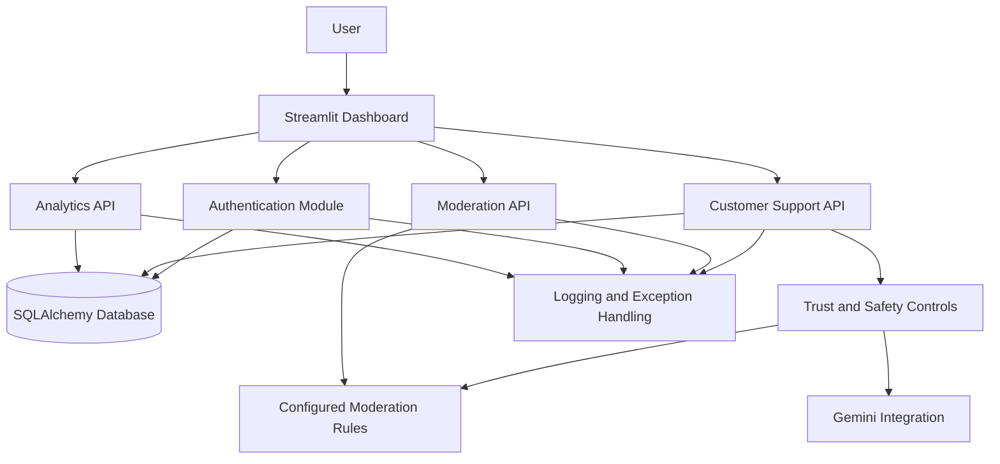
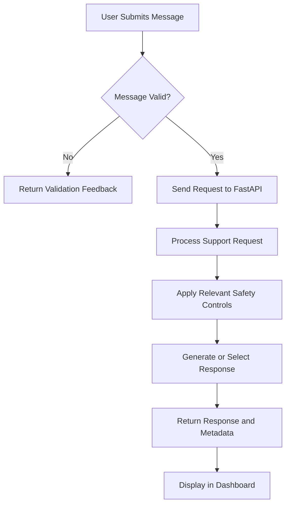
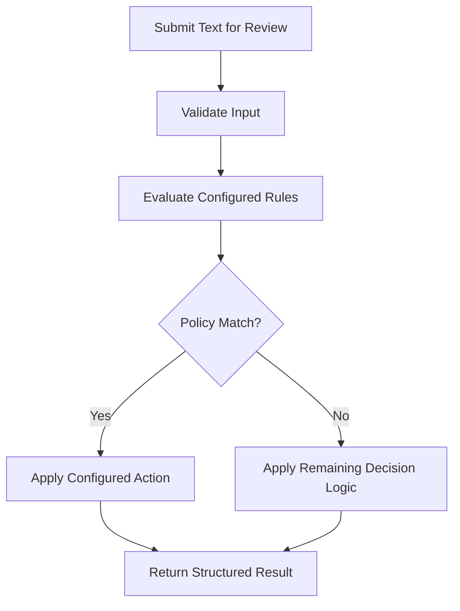

# TrustGuard AI
### Intelligent Customer Support Automation & Trust Safety Platform

**Secure Conversations. Intelligent Decisions. Trusted Automation.**

TrustGuard AI is a Python-based customer support and trust-and-safety platform designed to combine conversational assistance, content moderation, authentication, and operational analytics in a modular application.

The platform brings together a FastAPI backend and a Streamlit interface to support customer conversations, evaluate potentially unsafe content, and expose structured moderation decisions. It is designed with extensibility, observability, and secure application development in mind.

## Overview

Customer support systems must do more than answer questions. They also need to handle potentially abusive messages, enforce communication policies, protect authenticated operations, and provide visibility into application activity.

TrustGuard AI explores this challenge through a unified application that combines customer support automation with trust-and-safety controls.

### Project Objectives

- Provide an interface for customer support conversations.
- Evaluate submitted text through a dedicated moderation workflow.
- Return structured moderation decisions and supporting metadata.
- Support user registration and authentication.
- Integrate AI-powered capabilities through Google's Gemini API.
- Expose operational analytics for chat activity and moderation checks.
- Maintain a modular backend with centralized configuration, logging, and exception handling.
- Support containerized execution through Docker Compose.

## Problem Statement

Traditional customer support workflows can face several challenges:

1. **Unsafe communication:** Messages may contain profanity or other content that violates configured policies.
2. **Inconsistent handling:** Moderation decisions should follow a defined and inspectable process.
3. **Fragmented workflows:** Customer assistance and safety checks are often implemented as separate systems.
4. **Limited observability:** Developers need visibility into request volume, moderation activity, latency, and application failures.
5. **Application security:** Account-based operations require authentication and appropriate access controls.

TrustGuard AI addresses these engineering challenges through a modular support and moderation application.

## Solution

TrustGuard AI combines the following application components:

- **Customer Support Assistant:** Accepts user messages and returns structured conversational responses.
- **Trust and Safety Engine:** Evaluates submitted text and returns a moderation action, category, confidence, reason, and decision source where applicable.
- **Authentication Module:** Provides account registration and login with token-based authentication.
- **AI Integration:** Supports Gemini API configuration for AI-assisted application functionality.
- **Analytics Module:** Exposes operational statistics for chat requests, moderation checks, and average chat latency.
- **Web Interface:** Provides a Streamlit dashboard for interacting with the backend.
- **Application Infrastructure:** Uses environment-based configuration, database integration, logging, exception handling, and Docker support.

## Key Features

### 1. Intelligent Customer Support

- Submit customer messages through the support interface.
- Receive a structured assistant response.
- Expose conversation metadata, including intent, moderation action, response source, and request ID.
- Support authenticated order-related queries and refund-request workflows where implemented.

### 2. Content Moderation

- Submit text for independent moderation checks.
- Apply configured moderation rules.
- Return a structured action such as `block` when a configured rule matches.
- Include the category, confidence, reason, and source in the moderation result where available.
- Support a configurable moderation review threshold.

### 3. Authentication and Account Management

- Register an account using an email address and password.
- Sign in to obtain an access token.
- Send authenticated requests using a Bearer token.
- Maintain authentication state in the Streamlit browser session.
- Validate password length and confirmation in the registration interface.

### 4. Operational Analytics

- Track total chat requests.
- Track moderation checks.
- Expose average chat latency.
- Retrieve operational statistics through a dedicated analytics endpoint.

### 5. Backend Engineering

- FastAPI-based API architecture.
- Pydantic-based request and configuration validation.
- SQLAlchemy database integration.
- Centralized application configuration.
- Custom exception handling and structured logging.
- Automated tests using pytest.

### 6. Containerization

- Docker-based application packaging.
- Docker Compose configuration for the API and dashboard.
- Configurable API connectivity between services.
- Persistent Docker volume configuration for application data.


## System Architecture



### Architecture Layers

| Layer | Responsibility |
|---|---|
| Presentation | Streamlit-based user interface |
| API | FastAPI endpoints and request handling |
| Authentication | Registration, login, and token-based access |
| Business Logic | Customer support processing and moderation decisions |
| AI Integration | Configurable Gemini API integration |
| Data Access | SQLAlchemy and configured database |
| Observability | Logging, exception handling, and operational analytics |
| Deployment | Docker and Docker Compose |

The architecture separates the user interface from the API layer, allowing backend endpoints to be tested independently and potentially reused by other clients.

## Conversation and Moderation Workflows

### Customer Support Workflow



### Trust and Safety Workflow



The exact moderation behavior depends on the configured rules and implemented decision logic. A rule match should not be interpreted as proof that every form of harmful content can be detected.

---

## Technology Stack

| Technology | Purpose |
|---|---|
| Python 3.12+ | Core application language |
| FastAPI | REST API development |
| Uvicorn | ASGI application server |
| Streamlit | Interactive dashboard |
| Google Gemini API | AI integration |
| Pydantic | Data validation and settings |
| SQLAlchemy | Database ORM |
| SQLite / MySQL | Database options, depending on configuration |
| PyMySQL | MySQL connectivity |
| PyJWT | JWT-based authentication support |
| pytest | Automated testing |
| Docker | Application containerization |
| Docker Compose | Multi-service orchestration |
| Git | Version control |

**Note:** Actual database selection depends on the `DATABASE_URL` configuration. Some libraries being installed does not mean every integration is enabled in every deployment.


## Installation and Setup

### 1. Clone the repository

```bash
git clone https://github.com/krishkydv77/TrustGuard-AI.git
cd TrustGuard-AI
```

### 2. Create a virtual environment

**Windows PowerShell**

```powershell
py -3.12 -m venv .venv
.venv\Scripts\Activate.ps1
```

### 3. Install dependencies

Using pip:

```bash
python -m pip install --upgrade pip
pip install -r requirements.txt
```

Alternatively, if using the project's UV lockfile:

```bash
uv sync
```

Choose one dependency-management workflow and keep it consistent with the project's lockfile.

## Environment Configuration

Create a local `.env` file from the example configuration.

**Windows PowerShell**

```powershell
Copy-Item .env.example .env
```


Configure the environment variables:

```dotenv
APP_NAME=TrustGuard AI
ENVIRONMENT=development

DATABASE_URL=sqlite:///./safeassist.db

GEMINI_API_KEY=your_gemini_api_key
GEMINI_MODEL=gemini-2.5-flash

REDIS_URL=

JWT_SECRET_KEY=replace-with-a-long-random-secret
JWT_EXPIRE_MINUTES=60

CORS_ORIGINS=http://localhost:8501
MODERATION_REVIEW_THRESHOLD=0.45
```

### Configuration Reference

| Variable | Purpose |
|---|---|
| `APP_NAME` | Application name |
| `ENVIRONMENT` | Runtime environment |
| `DATABASE_URL` | Database connection string |
| `GEMINI_API_KEY` | Gemini API credential |
| `GEMINI_MODEL` | Configured Gemini model |
| `REDIS_URL` | Optional Redis connection setting |
| `JWT_SECRET_KEY` | Secret used by token-related functionality |
| `JWT_EXPIRE_MINUTES` | Token expiration duration |
| `CORS_ORIGINS` | Allowed browser origins |
| `MODERATION_REVIEW_THRESHOLD` | Configured moderation review threshold |

**Security requirements:**

- Replace the example JWT secret with a cryptographically random secret.
- Never commit `.env` or real API credentials.
- Use separate secrets for development and production.
- Configure the database URL for the database you actually intend to use.
- Confirm how the moderation threshold is consumed by the implementation before changing it.

## Running the Application

### 1. Start the FastAPI backend

From the repository root:

```bash
uvicorn app.main:app --reload --host 127.0.0.1 --port 8000
```

The API will be available at:

- API root: `http://127.0.0.1:8000/`
- Swagger UI: `http://127.0.0.1:8000/docs`
- ReDoc: `http://127.0.0.1:8000/redoc`

### 2. Start the Streamlit dashboard

Open another terminal, activate the same virtual environment, and run:

```bash
streamlit run streamlit_app.py
```

Open the dashboard at:

`http://localhost:8501`

The dashboard defaults to the backend API base URL:

`http://127.0.0.1:8000/api/v1`

If the backend runs elsewhere, set `TrustGuard-AI_API_URL` to the appropriate base URL.

### 3. Explore the dashboard

The interface provides three main workspaces:

- **Support Chat:** Submit customer messages and inspect response metadata.
- **Moderation Playground:** Submit text and inspect the resulting moderation decision.
- **Analytics:** Retrieve operational statistics.

Account registration and sign-in are available through the dashboard.

---

## API Documentation

FastAPI generates interactive API documentation from the application's registered routes and schemas.

After starting the backend, open:

**Swagger UI:** `http://127.0.0.1:8000/docs`

Use Swagger UI to inspect request schemas, execute API calls, and examine responses.

## API Endpoints

The following endpoints are registered by the application.

| Method | Endpoint | Purpose |
|---|---|---|
| `GET` | `/` | Application information and documentation links |
| `GET` | `/api/v1/health/live` | Liveness check |
| `POST` | `/api/v1/auth/register` | Register a user |
| `POST` | `/api/v1/auth/login` | Authenticate a user |
| `POST` | `/api/v1/chat` | Submit a support message |
| `POST` | `/api/v1/moderation/check` | Evaluate text for moderation |
| `GET` | `/api/v1/analytics/overview` | Retrieve operational statistics |

The API prefix is configurable. Request schemas, response fields, and authentication requirements should be verified in Swagger UI for the running version.

### Example: Moderation Request

```bash
curl -X POST "http://127.0.0.1:8000/api/v1/moderation/check" \
  -H "Content-Type: application/json" \
  -d "{\"text\":\"Your message to evaluate\"}"
```

### Example: Chat Request

```bash
curl -X POST "http://127.0.0.1:8000/api/v1/chat" \
  -H "Content-Type: application/json" \
  -d "{\"message\":\"Where is my order?\"}"
```

Authenticated order-related operations may require a valid Bearer token.

---

## Example Moderation Response

A rule-based moderation decision can be represented in a structured format like this:

```json
{
  "category": "profanity",
  "action": "block",
  "confidence": 0.96,
  "reason": "Matched a configured profanity term.",
  "source": "rules"
}
```

This illustrates the moderation result structure observed during development. It is an example, not a guarantee that every request returns these exact values.

### Why Structured Decisions Matter

- **Category:** Identifies the policy category involved.
- **Action:** Indicates the configured moderation outcome.
- **Confidence:** Represents the confidence value returned by the implemented logic; it should not automatically be interpreted as a calibrated probability.
- **Reason:** Provides an explanation for the decision.
- **Source:** Identifies the mechanism responsible for the result, where available.

Structured results make moderation decisions easier to inspect, test, debug, and integrate into downstream applications.


## Testing

Run the project's automated tests using pytest:

```bash
pytest -v
```

To run tests with Python's module invocation:

```bash
python -m pytest -v
```

## Docker Deployment

The repository includes a Dockerfile and Docker Compose configuration for the API and Streamlit dashboard.

### Start the services

Ensure the `.env` file is configured, then run:

```bash
docker compose up --build
```

The configured services expose:

| Service | Local URL |
|---|---|
| FastAPI | `http://localhost:8000` |
| Streamlit | `http://localhost:8501` |
| Swagger UI | `http://localhost:8000/docs` |

### Stop the services

```bash
docker compose down
```

### View logs

```bash
docker compose logs -f
```

For production deployments, review database persistence, secrets, container permissions, health checks, and network exposure before making the service publicly accessible.

---

## Logging and Exception Handling

TrustGuard AI includes dedicated logging and exception-handling modules.

These components support operational diagnostics by recording relevant application events and handling application exceptions consistently.

Recommended engineering practices include:

- Record useful request and application context.
- Use consistent log levels.
- Avoid logging passwords, access tokens, API keys, or unnecessary personal data.
- Return safe error messages to clients.
- Preserve diagnostic details in appropriately protected server-side logs.
- Rotate and restrict access to production log files.

## Security Considerations

Security is an ongoing engineering requirement, not a single feature.

Before production use, review:

1. **Authentication:** Verify token validation, expiration, and access-control rules.
2. **Credential management:** Store secrets in environment configuration or an appropriate secret manager.
3. **Database security:** Apply least-privilege database credentials and secure connections.
4. **Input validation:** Validate incoming requests and enforce suitable input-size limits.
5. **Moderation reliability:** Test policy rules against false positives, false negatives, and adversarial inputs.
6. **Privacy:** Minimize sensitive data collection and avoid retaining unnecessary customer conversations.
7. **API protection:** Add suitable rate limiting, monitoring, and abuse prevention.
8. **CORS:** Restrict browser origins to explicitly trusted clients.
9. **AI safety:** Treat AI-generated responses as potentially incorrect and validate sensitive actions.
10. **Production deployment:** Disable development reload, use HTTPS, and configure appropriate infrastructure-level controls.

Moderation controls can reduce certain risks but cannot guarantee that all harmful content or malicious requests will be detected.


**TrustGuard AI — Secure Conversations. Intelligent Decisions. Trusted Automation.**
